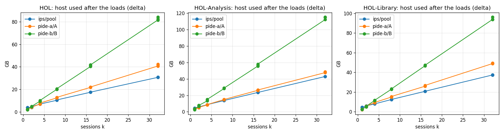
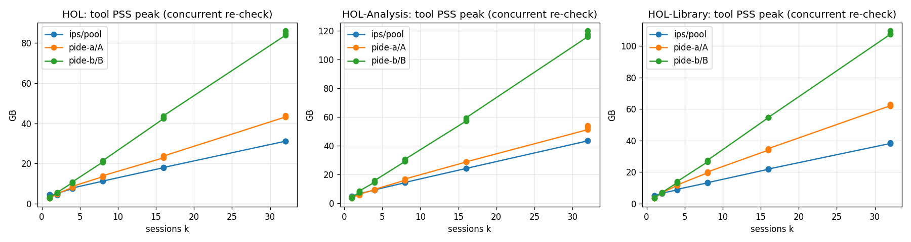

# Memory and capacity with many sessions: IPS vs PIDE MCP

Status: measured on the Ubuntu server on 2026-10-21 (release `memscale-2026-10-21b`, 162 of 162 matrix cells ok,
E2–E4 complete). Everything here is deterministic (no LLM). Experiment code: `evaluation/memory_scaling/`
(plan `claude-work/2026-10-20-plan-memory-scaling-experiments/`); tables generated by `memscale.analyze`
(`results/REPORT_SNIPPET.md`, `results/tables/{cells,series}.csv`); plots under `results/plots/`.

## Setup

- Host: `wenda-Amd-Wrx80`, x86_64, 32 logical CPUs, 125.6 GiB MemTotal; kernel 6.11.0-26-generic (Ubuntu),
  cgroup v2, systemd user scopes (`systemd-run --user --scope`, OOMPolicy=continue for the E3 PIDE scope).
  Both tools native on the host, one user, nothing else running.
- Isabelle: Isabelle2026-RC2, id `f79fcaa14d19`, one installation for both tools. `ML_OPTIONS` =
  `--minheap 500 --enablegcsharing --maxheap 9216` (the same per-process heap cap for every `poly` of both
  tools, written by IPS's `ensure_settings.sh`); `ISABELLE_TOOL_JAVA_OPTIONS` = `-Xms512m -Xmx4g -Xss16m`
  (+ GC logging). Heaps HOL / HOL-Library / HOL-Analysis built once (4 s / 114 s / 360 s).
- IPS: commit `6e4dd6f` of `Impl-memory-robustness`, memory management ON with defaults (pressure threshold
  85 %, warning 70 %, min available 512 MB, session estimates HOL 2048 / HOL-Library 3072 / HOL-Analysis 4096 MB),
  `ISABELLE_POOL_SIZE=40`, `ISABELLE_INITIAL_SESSIONS=0`, `parallel_proofs=2`, `threads=4` (IPS defaults).
  Each cell starts a fresh server in its own systemd scope.
- PIDE MCP: `isabelle pide_mcp` (server `isabelle_pide_mcp` 0.1.0, `main` pinned to RC2), started with no `-o`
  options (Isabelle's session defaults). Topology A: one MCP process, k sessions. Topology B: k processes,
  one session each (one MCP server per agent — not the tool's intended deployment; see threats).
- Workloads (one fixed theory per heap, sha256 in every manifest): `CTL.thy` (HOL, 288 commands),
  `Termination.thy` (HOL-Library), `Sum_Topology.thy` (HOL-Analysis, 163 lines, imports
  `HOL-Analysis.Abstract_Topology`). P5 inserts `lemma memscale_p5_done: "True" by simp` after the first
  paragraph under the same theory name, so every later command is re-checked on the incremental path.
- Phases per cell: P0 baseline 60 s (10 s after the first cell of a series), P1 start k sessions, P2 idle 60 s,
  P3 load the theory in each, P4 settle 60 s, P5 concurrent re-check, P6 stop + 30 s tail; sampler 1 s;
  steady state = median of the last 30 s of a phase. k ∈ {1, 2, 4, 8, 16, 32}, 3 repeats at every k
  (162 cells); series stop at 110 GB host used (never reached).

## What was measured

- Per process under each tool (one external `/proc` sampler, `smaps_rollup`): RSS, **PSS** (the headline:
  heap images are file-backed and partly shared between `poly` processes of one heap), USS; per tool the sum
  by role (JVM / prover); host used = MemTotal − MemAvailable, reported as the **delta over the cell's own P0**
  so the fit's intercept is the tool's fixed cost, not the host's standing load; the tool's cgroup
  `memory.current` / `memory.peak` / `oom_kill`.
- Per (tool, heap): least-squares marginal memory per session and fixed cost over k, on PSS and on host used;
  "sessions per 100 GB" = (100 GB − fixed) / marginal on the host-used slope; the JVM's growth over a series;
  start / load / re-check latencies (p50, p95 over sessions, then over cells).

## E1 — capacity curves

*Figure E1a: host used after the loads (delta over the cell's baseline) vs k, one panel per heap, three
repeats per point.*

*Figure E1b: tool PSS at the concurrent re-check (P5 peak).*

| tool | heap | marginal MB/session (host, settled) | fixed MB (host) | marginal MB/session (PSS, settled) | fixed MB (PSS) | peak marginal (PSS) | sessions per 100 GB | start p50/p95 s | load p50/p95 s | re-check p50/p95 s |
|---|---|---|---|---|---|---|---|---|---|---|
| IPS (pool) | HOL | 894 | 3183 | 886 | 3750 | 887 | **110** | 2.3/3.9 | 3.1/4.1 | 1.0/3.3 |
| IPS (pool) | HOL-Library | 1084 | 3740 | 1077 | 4336 | 1092 | **90** | 3.4/5.1 | 9.2/10.0 | 6.9/16.8 |
| IPS (pool) | HOL-Analysis | 1271 | 3541 | 1263 | 4150 | 1267 | **77** | 6.0/8.2 | 6.8/7.5 | 1.3/5.1 |
| PIDE MCP A | HOL | 1279 | 1876 | 1266 | 2453 | 1320 | 78 | 2.0/3.2 | 1.2/2.2 | 1.2/11.8 |
| PIDE MCP A | HOL-Library | 1513 | 2467 | 1495 | 3092 | 1915 | 66 | 3.0/4.3 | 7.2/7.4 | 8.5/23.5 |
| PIDE MCP A | HOL-Analysis | 1476 | 2671 | 1461 | 3265 | 1602 | 67 | 5.8/7.1 | 1.1/1.4 | 1.8/10.7 |
| PIDE MCP B | HOL | 2665 | −581 | 2630 | 17 | 2712 | 38 | 3.1/3.2 | 1.4/1.5 | 1.3/9.7 |
| PIDE MCP B | HOL-Library | 3047 | −620 | 3017 | −68 | 3466 | 33 | 4.1/4.2 | 7.3/8.3 | 8.6/25.6 |
| PIDE MCP B | HOL-Analysis | 3660 | −232 | 3604 | 451 | 3753 | 28 | 6.7/7.3 | 1.3/1.4 | 1.8/11.2 |

Fits over k = 1…32 (18 cells per row); the PSS and host-delta slopes agree within 1 %. A negative fixed cost
is the intercept of a straight fit through points that all carry at least one JVM: PIDE B has no process
at k = 0.

JVM PSS after the loads, by k (MB) — the growth of the gateway / MCP JVM over a series:

| tool | heap | k=1 | 2 | 4 | 8 | 16 | 32 |
|---|---|---|---|---|---|---|---|
| IPS gateway | HOL | 3645 | 3513 | 4242 | 4630 | 5049 | 5259 |
| IPS gateway | HOL-Library | 4057 | 4456 | 4517 | 4886 | 5026 | 5160 |
| IPS gateway | HOL-Analysis | 3879 | 4294 | 4559 | 4762 | 4979 | 5212 |
| PIDE MCP A | HOL | 1543 | 2608 | 3881 | 4327 | 4694 | 5058 |
| PIDE MCP A | HOL-Library | 1591 | 3377 | 4225 | 4526 | 4681 | 4989 |
| PIDE MCP A | HOL-Analysis | 2708 | 3196 | 4000 | 4511 | 4867 | 4878 |
| PIDE MCP B (sum of k JVMs) | HOL | 1539 | 3028 | 6056 | 12064 | 23964 | 47860 |
| PIDE MCP B (sum of k JVMs) | HOL-Library | 1580 | 3106 | 6236 | 12369 | 24805 | 49242 |
| PIDE MCP B (sum of k JVMs) | HOL-Analysis | 2732 | 5550 | 10304 | 18836 | 37022 | 72194 |

Reading:

- **IPS** = one gateway JVM (3.5–5.3 GB, growing by about 0.2 GB per doubling of k under the 4 GB `-Xmx` plus
  metaspace/native) + one prover per session at 0.9 / 1.1 / 1.3 GB (HOL / HOL-Library / HOL-Analysis). The
  per-session cost is the prover alone; the pool holds 77–110 sessions per 100 GB.
- **PIDE MCP A** = one MCP JVM (1.5–5.1 GB) + one prover per session, but each session costs 1.2–1.5 GB,
  i.e. 0.2–0.4 GB more than under IPS. The difference is Isabelle's session defaults (PIDE MCP passes no
  options; the IPS server sets `parallel_proofs=2`, `threads=4` and shares the heap cap) and the PIDE document
  model's per-session state inside the JVM. Latencies are the same class as IPS: start 2–6 s, load 1–7 s.
- **PIDE MCP B** = one JVM + one prover per session: 2.7 / 3.0 / 3.7 GB per session, 3× IPS, because every
  agent pays a 1.5–2.3 GB JVM. 28–38 sessions per 100 GB; the k = 32 HOL-Analysis cells used 118–122 GB of the
  128 GB host. The concurrent re-check costs the most here too (peak marginal 3.5–3.8 GB).
- All three scale linearly up to k = 32; nothing hit the 110 GB stop. The P5 peak adds only 1–3 % over the
  settled state for IPS and PIDE A (the re-check runs inside the prover's existing heap) and 2–14 % for PIDE B.

## E2 — start latency

Cold start (P1, from the E1 cells; p50/p95 over sessions, max p95 over cells):

| heap | IPS | PIDE MCP A | PIDE MCP B |
|---|---|---|---|
| HOL | 2.3 / 3.9 s | 2.0 / 3.2 s | 3.1 / 3.2 s |
| HOL-Library | 3.4 / 5.1 s | 3.0 / 4.3 s | 4.1 / 4.2 s |
| HOL-Analysis | 6.0 / 8.2 s | 5.8 / 7.1 s | 6.7 / 7.3 s |

IPS warm hit (`warm-ips-<heap>`, k = 4, 3 rounds: release a session, acquire again with the same imports):

| heap | cold p50 | warm p50 | reused / same session |
|---|---|---|---|
| HOL | 2.2 s | 0.002 s | 12 / 12 |
| HOL-Library | 3.1 s | 0.002 s | 12 / 12 |
| HOL-Analysis | 5.8 s | 0.002 s | 12 / 12 |

A released IPS session is handed back in 2 ms, 1000× faster than a cold start; PIDE MCP has no pool, so
every new agent pays the cold start (and, in topology B, a JVM start on top).

## E3 — pressure under a 48 GB limit (HOL-Analysis)

Both tools under a systemd scope with `MemoryMax=48G`; sessions added one at a time, each loading the theory,
until the tool refuses or something dies; then half the sessions are released and one more is added.

| | IPS (pool, own scope) | PIDE MCP B (experiment under the scope) |
|---|---|---|
| sessions admitted before the stop | **27** | 13 |
| how it stopped | 28th refused: HTTP 503 `memory_pressure` | kernel OOM kill inside the scope |
| scope memory at the stop | 38.4 GB used (78 %), peak 38.4 GB | 48.0 GB = the limit (peak = max) |
| processes lost | none (`oom_kill` 0) | 4 MCP JVMs (+ 3 provers): 4 of 13 sessions dead |
| recovery after releasing half | 8.4 s to the next successful load | 8.6 s to the next successful load |

IPS's 503 body says why: `state: warning`, 38 382 MB used of 49 152, 10 770 MB available, and the next
HOL-Analysis session's 4096 MB estimate does not fit under the 85 % threshold; every running session was
leased, so nothing was evictable, and the server told the client to retry in 5 s. All 27 sessions stayed
intact. PIDE MCP B admitted its 13th session only because the kernel freed memory by killing four of the
existing MCP servers (each a JVM with its prover); those four agents lost their sessions without any
notification from the tool. `dmesg` was not readable by the unprivileged user; the kill count is the
scope's `memory.events oom_kill`.

## E4 — isolation

k = 8 sessions on HOL, the newest session's prover (`poly`) killed with SIGKILL, every session then asked for
an answer within 30 s (IPS: a re-check through `load_document`; PIDE: `get_state`).

| tool | others answered | victim's session | tool processes alive |
|---|---|---|---|
| IPS | 7 / 7 | `prover process died … the session has been discarded, open a new one` (404 `prover_died`) | gateway JVM + server: yes |
| PIDE MCP A | 7 / 7 | `No running session "s7"` (MCPError) | the one MCP JVM: yes |
| PIDE MCP B | 7 / 7 | `No running session "s7"` (MCPError) | all 8 MCP JVMs: yes |

All three tools isolate a prover death: the other seven sessions answer, the victim is reported as gone.
IPS additionally names the cause and frees the slot in the pool.

## Threats to validity

- Topology B is not PIDE MCP's intended deployment; it measures the cost of one process per agent, not a
  defect of the tool.
- The two tools do not run Isabelle with identical session options (IPS: `parallel_proofs=2`, `threads=4`;
  PIDE MCP: Isabelle's defaults); the per-session difference between IPS and PIDE A (0.2–0.4 GB) is partly that.
- PSS attribution of shared heap pages changes with k by construction; host used (delta) is reported alongside
  and agrees within 1 %.
- One fixed theory per heap bounds "memory after work" from below; P5 is a burst, not a steady load.
- Every `poly` runs under IPS's heap cap (`--maxheap 9216`, the same for both tools); uncapped runs are out
  of scope.
- One cell of the first round (`ips/HOL k=16 rep1`) was contaminated by a second runner and was re-run; the
  runner now refuses to start twice on one results tree and the analysis flags interleaved samples.
